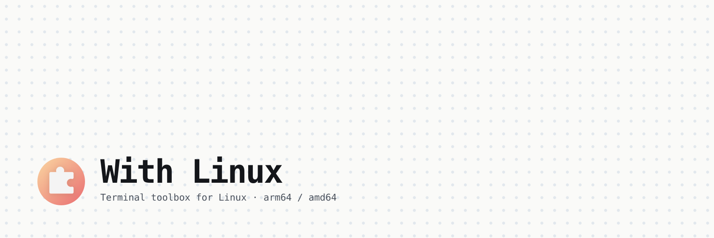

<picture>
  <source media="(prefers-color-scheme: dark)" srcset="assets/banner-dark.svg">
  
</picture>

# With Linux

面向 arm64 / amd64 Linux 的轻量 TUI 控制面板，通过 SSH 按需启动，命令名为 `wl`。

<p>
  
  
</p>

> 本项目由 AI 协作完成：代码、文档与迭代均经 AI 生成和优化。

## 功能

- 实时查看 CPU、内存、磁盘、网络、温度和系统负载。
- 查看并控制本机 Docker 容器，浏览最近日志。
- 查看 Caddy 路由、上游状态和配置文件，并执行热重载。
- 在面板内查看 OpenCode Go 与 Command Code 的用量。
- 支持鼠标、键盘、窄终端和单文件部署。
- 所有系统/服务面板可单独开关；相邻面板的共享边框可拖拽调整宽高，比例跨启动恢复。

## 开发

版本号保存在仓库根 `VERSION`。开发期保持版本号不变，只有正式发版时才提升；完成验证后可继续用同一版本构建并覆盖安装。

```bash
bash scripts/mkdeb.sh "$(dpkg --print-architecture)"
sudo dpkg -i "dist/with-linux_$(cat VERSION)_$(dpkg --print-architecture).deb"

go build -o wl ./cmd/wl
gofmt -l .
go mod tidy -diff
go vet ./...
go test ./...
```

## 许可证

本项目使用 [MIT 许可证](LICENSE)。
