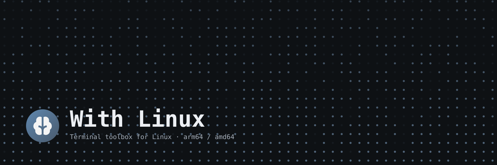

#  With Linux


> 本项目由 AI 协作完成：代码、文档与迭代均经 AI 生成和优化。

个人自用的 Linux 控制面板（TUI）：面向 arm64 / amd64，SSH 使用、按需启动。命令名 **`wl`**。

## 功能

**系统状态**：每秒采样本机 CPU（上下镜像填充图：总占用 ↑ / 最忙核 ↓；右栏是两列多核、用量条、用户/系统/IO 分解与温度/负载，高度够时包进「核心」子线框，标题左侧带型号、右上角显示平均频率；每核小图一个点列 1 秒）、内存与磁盘（内存是使用率历史图＋单个「已用」进度条＋可用/缓存/空闲/Swap 明细；Swap 只显示已用/总量；磁盘是更高的读/写镜像历史图＋根目录 `/` 单个进度条，其他挂载点收成路径与占用率摘要）、网络（宽面板时左侧下载 ↓ / 上传 ↑ 镜像填充图，上下基线紧邻且各自保持蓝/青序列色，右侧「速率」子框放速率、方块条与累计，标题带网卡 IP；窄面板回退上下布局）；运行时长与当前时间在标题栏。Docker 卡在高度足够时显示 `容器 / CPU / 内存 / 状态` 列头。宽屏布局按 btop 组织：CPU 一整行；下半区默认约 3:2 放左侧内存/磁盘与整行网络、右侧 AI 用量/Docker/Caddy；内存两列不足时从右侧服务栏借少量宽度，内存与磁盘保持等宽；窄屏回退两栏并在底部保留两行服务摘要。CPU 温度/负载、内存和磁盘明细、网络累计与错误、Docker/Caddy 摘要统一为“标签贴左、数值贴右”的等宽列，数字与百分比纵向对齐；空间不足自动降列。Docker/Caddy 正文超出卡片时可用滚轮独立滚动；只有对应方向确有隐藏行时边缘渐隐，且压暗的是原前景色、保留状态色，短列表不渐隐。放大 CPU 时右栏每核历史图扩为多行；放大网络时右栏补充接口、IPv4、累计、错误/丢包；放大内存/磁盘时历史图吃满新增高度。主图历史保留 2 分钟，一个采样固定占一个 braille 点列；网络/磁盘新采样按当时量程冻结高度，后续峰值只影响新点，旧图只左移、不回写。图表用 braille 点阵、电平值用 `■` 方块进度条；分类标题用细线连接标签与数值；面板线框按 btop 风格分色、盒子紧挨着；内容不足高度时补明细/分隔线，不留空白块。

**Docker**：状态卡列出容器（名称、CPU%、内存，右侧 `UP`/`EXIT` 等短状态）并显示总数/运行数与总 CPU/内存；点击卡片打开管理弹窗，查看容器统计，点 `[启动]`/`[停止]`/`[重启]` 直接执行，并可查看最近 200 行日志（滚轮、`[过滤]`、`[刷新]`）。只通过本机 Docker socket 调用受控端点，不提供 exec、删除或镜像/Compose 管理。

**Caddy**：状态卡用两列展示配置里的域名与反向代理目的端口，并显示管理 API、路由数与上游健康；点击卡片打开弹窗，查看 systemd 只读状态，点 `[刷新]` 重新取数、点 `[配置文件]` 在弹窗内只读查看 Caddyfile（支持滚轮，最多读取 2 MiB）、点 `[重载配置]` 热重载 Caddyfile。不做启停/重启或配置编辑；超长域名/容器名/日志行在边缘渐隐。

**AI 用量**：OpenCode Go 与 Command Code 的 5 小时 / 每周 / 月度额度，每个窗口固定一行，面板固定 5 行；百分比和重置倒计时分别右对齐。宽屏时放在右侧服务栏顶部、Docker 上方并排，页面变高时多余高度给 Docker/Caddy，两个面板都能关掉。**API 出错时可直接点击面板重试**。

**设置弹窗**：点标题栏右上角的 `[ 设置 ]` 打开，填写各提供商的 API Key 并写回配置文件；行首勾选框控制对应面板是否展示；「关于」里显示版本、构建日期、commit、Go 版本与平台。编辑时点 `[保存]`/`[取消]`，平时点 `[关闭]` 或弹窗外侧关闭。

界面只有「标题栏（左：程序名/主机名/运行时长，右：当前时间＋设置按钮）＋ 系统状态网格」，**没有底部状态栏，键盘只保留 `q` 退出**，其余操作全部用鼠标。设置/Docker/Caddy 都是居中的弹窗，打开时背景整屏灰化、不响应输入；**点击弹窗外侧关闭**。弹窗操作按钮行首按钮贴左、末按钮贴右。点击 CPU/内存/磁盘/网络面板标题行可全屏放大，点击内容或右上角 `[ 返回布局 ]` 恢复。窄屏 / 矮屏逐级降级（宽 <120 回退旧两栏＋服务摘要，宽 <60 单列堆叠；高度不足逐级丢元素，再放不下进紧凑模式）。

## 文档

安装、配置与开发约定的细节都在下面几份里：

- [AGENTS.md](AGENTS.md) —— 项目章程：目标 / 非目标 / 验收标准 / 界面布局 / 工作流指令
- [CHANGELOG.md](CHANGELOG.md) —— 版本变更
- [PLAN.md](PLAN.md) · [FINDINGS.md](FINDINGS.md) · [PROGRESS.md](PROGRESS.md) —— 计划、调研结论、进度与验证记录
- [web/](web/README.md) —— 介绍页（本地预览用，暂不对外发布）

## 开发

```bash
go build -o wl ./cmd/wl     # 交叉编译：GOOS=linux GOARCH=arm64 go build -o wl ./cmd/wl

gofmt -l .
go mod tidy
go vet ./...
go test ./...
```
